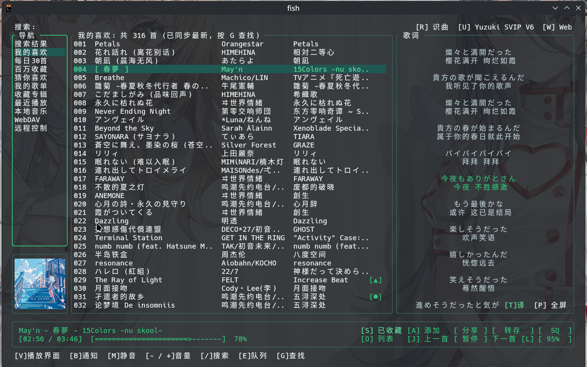
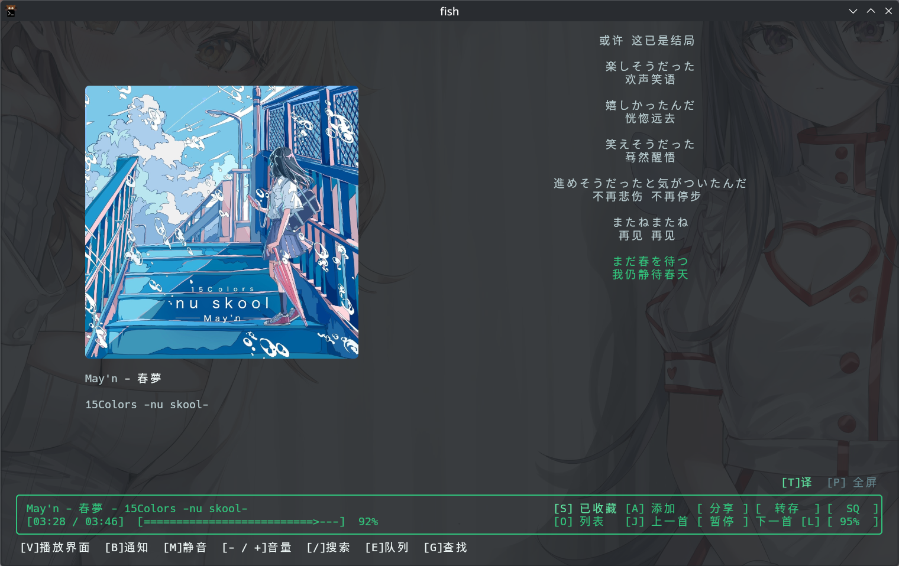

# qmtui

`qmtui` 是一款运行于终端的 QQ 音乐 TUI 客户端。

## 界面预览

### 主界面

### 播放界面

## 终端支持

- **基础文本模式**：支持所有标准终端环境。
- **封面图像显示**：基于 Kitty 图像协议，支持具备图像图层渲染的终端：
  - [Kitty](https://sw.kovidgoyal.net/kitty/)
  - [Ghostty](https://ghostty.org/)
  - [Rio](https://rioterm.com)
  - 在不支持图像协议的终端中，界面将自动回退至基础文本模式。
  - **图像协议环境变量**：
    - 强制开启：若您确定终端支持 Kitty 图像协议且实现规范可在使用以下环境变量强制开启 `QQMUSIC_FORCE_IMAGE=1`
    - 显式禁用：通过设置 `QQMUSIC_DISABLE_IMAGE=1`（或 `QQMUSIC_NO_IMAGE=1`）停用图像渲染

## 安装与发布包说明

在 GitHub Releases 页面提供以下类型的发布文件：

### 1. 便携包

| 类型 | 文件格式 | 说明 |
| :--- | :--- | :--- |
| **Windows** | `.zip` | 解压后直接运行 `qmtui.exe` |
| **macOS** | `.tar.gz` | 解压后在终端运行 `./qmtui`。 **依赖**：需通过 Homebrew 安装 GStreamer 运行库： `brew install gstreamer gst-plugins-base gst-plugins-good` *(可选，提供 AAC/M4A 解码支持)*：`brew install gst-libav` |
| **Linux** | `.tar.gz` | 解压后直接在终端运行 `./qmtui`。 **依赖**：需系统安装 GStreamer 1.0 基础组件： - Debian/Ubuntu: `sudo apt install libgstreamer1.0-0 gstreamer1.0-plugins-base gstreamer1.0-plugins-good libpulse0` - Arch Linux: `sudo pacman -S gstreamer gst-plugins-base gst-plugins-good libpulse` - Fedora: `sudo dnf install gstreamer1 gstreamer1-plugins-base gstreamer1-plugins-good pulseaudio-libs` 可选剪贴板工具：`wl-clipboard` (Wayland) 或 `xclip` (X11) |

### 2. 系统包

| 类型 | 说明与安装方式 |
| :--- | :--- |
| **Deb 包 (`.deb`)** | 适用于 Debian、Ubuntu、Deepin、UOS 等。安装时系统包管理器会自动处理依赖。 安装命令： `sudo apt install ./qmtui_*.deb` |
| **Arch Linux 包 (`.pkg.tar.zst` / AUR)** | `.pkg.tar.zst` 为 Arch Linux / Manjaro 的 Pacman 本地包格式。 - **AUR 安装**：包名为 `qmtui-bin`，推荐使用 AUR 助手自动安装与更新：   `yay -S qmtui-bin` 或 `paru -S qmtui-bin` - **本地包安装**：可下载 Release 中的 `.pkg.tar.zst` 文件直接安装：   `sudo pacman -U qmtui-bin-*.pkg.tar.zst` |

## 免责声明

1. **独立第三方开源工具**：`qmtui` 为开源社区独立开发与维护的终端播放客户端，与任何在线音乐服务平台或其关联公司**不存在任何形式的商业合作、授权、从属或背书关系**。
2. **版权与内容归属**：本项目不存储、托管或分发任何音频、歌词、封面及元数据文件。运行期间请求的所有音频流、歌词文本与多媒体资源之知识产权均归其合法版权方、唱片公司或平台所有。
3. **合法鉴权与非越权承诺**：本项目基于用户合法获取的凭据（如 Session/Cookie、本地媒体库或 WebDAV）进行标准化服务交互，**不提供任何绕过权限校验、破解付费限制、解密受保护数字版权管理（DRM）资产或批量抓取**的技术手段，播放权限与可用性完全由上游服务端依据用户账号状态裁定。
4. **非商业性与免责声明**：本项目仅供个人技术研究与学习交流使用，严禁用于任何商业盈利、二次包装销售或非法用途。用户使用本项目产生的网络请求与行为后果均由使用者自行负责，开发者不对因使用本软件引发的任何争议承担法律责任。
5. **账号风控与使用风险自负**：用户需知悉使用第三方客户端进行网络交互可能存在触发服务提供商安全策略或风控机制的潜在风险，由此产生的一切账号状态变动（如二次验证、接口频控、功能受限等）均由使用者自行承担。

## 许可证 (License)

本项目代码基于 [MIT License](LICENSE) 开源发布。
